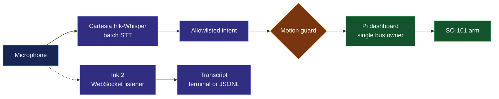

<h1 align="center">Third Hand</h1>

<p align="center"><em>An extra hand should be as easy to reach as your voice.</em></p>

Third Hand is an assistive robotics prototype built around a six-motor SO-101 arm and a Raspberry Pi 5. The goal is to let someone ask for an everyday object and have an arm bring it within reach. Today, the physical arm has guarded motion, a live motor dashboard, experimental kinematics, and a supervised voice-to-gripper path. **Autonomous camera-guided pickup and delivery are not implemented.**

## Why Third Hand

The project was inspired by a teammate's friend with quadriplegia. Moving a cup or repositioning an everyday item can mean waiting for help. We are investigating whether a lower-cost robotics stack can eventually make those actions available on demand. The gap between recognizing a request and moving a real object reliably is the central engineering problem.



The solid path is the current Pi voice-command path. The dotted path is a separate streaming transcription module: it emits text and **does not command the arm**.

## Stack

| Layer | Implementation | Responsibility |
| --- | --- | --- |
| Hardware | Raspberry Pi 5, URT-2, six-servo SO-101 follower | Physical arm and serial motor bus |
| Motor server | [`server.py`](server.py) | Single bus owner; live state, diagnostics, guarded jog, gripper, and saved poses |
| Motion | [`motion_core.py`](motion_core.py), [`arm_runtime.py`](arm_runtime.py), [`measured_pose_runner.py`](measured_pose_runner.py) | Synchronized plans and measured execution checks |
| Kinematics | [`so101_ik.py`](so101_ik.py) | Calibrated tick conversion and experimental local FK/IK |
| Pi voice | [`voice-test/pi_voice.py`](voice-test/pi_voice.py) | Batch STT, allowlisted intent, dry run, and one supervised gripper action |
| Streaming STT | [`voice-test/cartesia_mic_stream.py`](voice-test/cartesia_mic_stream.py) | Independent Ink 2 microphone-to-text WebSocket client |
| Concept demo | [`simulation/`](simulation/) | GPU-preferred Three.js visualization; no physical motor connection |

Motor order is shoulder pan, shoulder lift, elbow flex, wrist flex, wrist roll, and gripper. The Pi dashboard owns the URT-2 bus; a second process must not open it concurrently. The controller checks measured position, saved and firmware bounds, torque, faults, voltage, load, temperature, and movement progress. It holds torque after completed moves and faults. Saved Home and Fold actions use recorded encoder targets. Cartesian IK is experimental and is not a collision-aware pickup planner. See [runtime details](docs/ARM_RUNTIME.md) and [kinematics validation](docs/KINEMATICS.md).

## Speech: what Cartesia actually does

The Pi command prototype detects a local speech segment, sends the completed utterance to **Cartesia Ink-Whisper's batch speech-to-text API**, then checks the "Hey Arm" wake phrase. Exact supported phrases use local matching. Other wording can be classified by `openai/gpt-4.1-mini` through OpenRouter, but the result must match a fixed allowlist and pass transcript checks. **Neither Cartesia nor the classifier generates servo targets.**

Physical speech-driven movement starts in dry run. An operator can enable one gripper move for 120 seconds; the move is limited to 120 encoder ticks within the controller's effective bounds. "Pick up the can" is recognized but returns unsupported because there is no object position or grasp plan. Spoken stop requests go through speech detection, the network, and the dashboard; they are not an instantaneous physical emergency stop. See [Pi voice operation](voice-test/PI-README.md).

The separate [`cartesia_mic_stream.py`](voice-test/cartesia_mic_stream.py) sends approximately 100 ms chunks of 16 kHz mono signed 16-bit PCM to the **Ink 2 automatic-turn WebSocket API**. `turn.update` revises the current partial transcript; `turn.eager_end` is provisional; `turn.resume` may follow; and `turn.end` finalizes the utterance. Only text is printed or emitted as JSON Lines. This module is not wired into the Pi command path. See [Cartesia's Ink 2 model](https://docs.cartesia.ai/build-with-cartesia/stt/latest), [WebSocket events](https://docs.cartesia.ai/api-reference/stt/turns/websocket), and the [voice setup guide](voice-test/README.md).

## Simulation

The [Third Hand simulation](simulation/) shows a seated person requesting water and a wheelchair-mounted SO-101 visual model bringing a lidded cup into reach. Camera detection, grasping, delivery, and user interaction in this scene are **simulated**. It does not use the microphone, Cartesia, Raspberry Pi, or motors.

```bash
cd simulation
npm ci
npm run dev
```

Open the local URL printed by Vite. The guided scene starts automatically; **Start manually** lets you confirm the simulated cup and return it after the pause. Drag to orbit, scroll to zoom, press Space to pause, and press Escape to stop. Three.js requests a high-performance WebGL context and the UI reports the browser's actual renderer; the browser and OS choose the GPU. See [simulation controls and asset credits](simulation/README.md).

## Run the hardware and voice prototypes

The tested robot host is a Raspberry Pi 5 running Raspberry Pi OS. With authorized SSH access:

```bash
ssh robot@pi.local
systemctl --user status care-reach-dashboard.service
```

The dashboard is at `http://pi.local:8765` on the trusted local network. It has no login, so network access grants motor control. Follow the [Pi runtime guide](docs/PI_RUNTIME.md) before changing services or directly opening the serial bus. The [Pi voice guide](voice-test/PI-README.md) covers microphone setup, protected credentials, dry run, and one-move enable.

To run the **independent** Ink 2 listener from this checkout:

```bash
python3 -m venv voice-test/.venv
voice-test/.venv/bin/python -m pip install -r voice-test/requirements-stream.txt
voice-test/.venv/bin/python voice-test/cartesia_mic_stream.py --jsonl
```

Set `CARTESIA_API_KEY` in the environment, or use the Mac Keychain entry supported by the script. This sends microphone audio to Cartesia while running and prints transcripts only.

## What blocks pickup

1. **Perception:** identify and track the requested object using the cameras actually mounted on the system.
2. **Calibration:** measure camera intrinsics, the camera-to-robot transform, and the workspace. A pixel is not a motor target.
3. **Manipulation:** choose a reachable grasp, collision-checked approach, grip force, and lift trajectory.
4. **Model fit:** validate policies against this arm's calibration and limits. In the researched public SO-101 dataset, **18.47% of converted action frames exceeded this arm's saved bounds**. The ACT checkpoint is not deployed on the Pi. See [model findings](research/open_so101_motion/FINDINGS.md).
5. **Hardware reliability:** resolve voltage sag and motor faults before repeated loaded movements.
6. **Physical verification:** measure pickup success externally. A closed gripper or completed trajectory alone does not prove the object moved.

The next milestone is a repeatable, supervised pickup of one lightweight object in a measured workspace. Wheelchair navigation remains a future goal.

## Validation

The physical arm completed a full-scale six-joint Dance sequence on 2026-10-24 and individual dashboard-controlled movements. Nearby Cartesian trials completed without servo faults, but their endpoint estimates came from encoder readings and the model, not external tool measurement. No autonomous physical pickup or delivery has been demonstrated.

Run the offline tests in the configured Pi environment:

```bash
PYTHONPATH=~/worktrees/care-reach/lerobot-runtime-src .venv/bin/python -m unittest discover -s tests -q
```

The simulation's model, textures, and licenses are credited in its [README](simulation/README.md). The project repository does not currently contain a root license file; choose and add one before claiming a project-wide open-source license.
