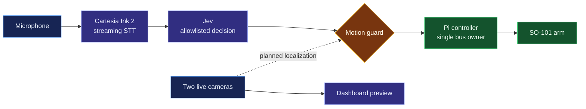

<h1 align="center">Third Hand</h1>

<p align="center"><em>An extra hand should be as easy to reach as your voice.</em></p>

Third Hand is an assistive robotics prototype built around a six-motor SO-101 arm, two live camera feeds, and a Raspberry Pi 5. The goal is to let someone request an everyday object and have the arm bring it within reach. Today, the arm responds to supported voice commands, streams motor telemetry and camera views, and runs guarded joint and gripper motions. **Autonomous camera-guided pickup and delivery are not implemented.**

## Why Third Hand

The project was inspired by a teammate's friend with quadriplegia. Moving a cup or repositioning an everyday item can mean waiting for help. We are investigating whether an affordable robotics stack can eventually make those actions available on demand. The distance between recognizing a request and manipulating a real object reliably is the central engineering problem.



Solid arrows are implemented. The dotted camera-to-motion path requires calibration, object localization, grasp planning, and physical validation.

## System

| Layer | Implementation | Responsibility |
| --- | --- | --- |
| Hardware | Raspberry Pi 5, URT-2, six-servo SO-101 | Physical arm and serial motor bus |
| Motor control | [`arm_control/`](arm_control/) | Exclusive bus lock, measured state, bounded movement, pose execution, telemetry |
| Dashboard | [`server.py`](server.py), [`static/`](static/) | HTTP control, diagnostics, camera relay, and live operator view |
| Cameras | Two Pi-local `ustreamer` services | MJPEG streams and latest-frame dashboard snapshots |
| Voice | [`voice/`](voice/) | Cartesia transcription, Jev command decision, direct-request checks, dashboard requests |
| Kinematics | [`so101_ik.py`](so101_ik.py) | Calibrated tick conversion and experimental local FK/IK |
| Concept demo | [`simulation/`](simulation/) | GPU-preferred Three.js visualization with no motor connection |

Motor order is shoulder pan, shoulder lift, elbow flex, wrist flex, wrist roll, and gripper. The dashboard is the normal **single owner** of the URT-2 serial bus; standalone motor programs must stop that service first. The controller checks measured position, joint and firmware bounds, torque, faults, voltage, load, and progress. A fault or stop holds the measured position; it does not automatically resume. Home/Retract and Extend use physically recorded tick poses. The historical Fold pose is blocked with the wrist camera attached. See the [motor runtime](ARM_RUNTIME.md), [Pi setup](docs/PI_RUNTIME.md), and [kinematics notes](docs/KINEMATICS.md).

## Voice pipeline

The Pi voice service defaults to **Cartesia Ink 2 over a WebSocket**. [`voice/streaming_stt.py`](voice/streaming_stt.py) sends paced, 100 ms chunks of 16 kHz mono `pcm_s16le`. Its bounded buffer favors current audio if the connection falls behind, and short microphone gaps are padded with silence so a stalled stream is not mistaken for a speaking pause.

Cartesia supplies speech-to-text and turn detection. `turn.update` is a partial transcript; `turn.eager_end` is provisional and may be followed by `turn.resume`; **only `turn.end` dispatches a completed utterance**. The service records turn, first-partial, and finalization timings. After repeated streaming failures, it falls back to an **Ink-Whisper batch transcription** path. The service starts with listening paused; pausing closes the stream and stops audio upload. See [Cartesia's Ink 2 documentation](https://docs.cartesia.ai/build-with-cartesia/stt/latest) and [WebSocket turn events](https://docs.cartesia.ai/api-reference/stt/turns/websocket).

The final transcript must contain **“Hey Arm”** and a command in the same utterance. Only text after the wake phrase is sent to **Jev (`typesafe/jev-1.14`) through OpenRouter** for a constrained command decision. The decision must match the local allowlist and pass direct-request checks before the voice service calls the Pi dashboard. Cartesia and Jev never output raw servo targets. Supported voice actions include Home/Retract, Extend, Dance, bounded gripper opening/closing, stop, and supported taught moves. “Pick up the can” is recognized but rejected as unavailable because no camera-derived grasp target exists.

Voice stop still depends on microphone capture, transcription, the network, and controller dispatch. It is **not an instantaneous physical emergency stop**. See [`voice/pi_voice.py`](voice/pi_voice.py) and [voice runtime installation](deploy/pi/install-voice-runtime.sh).

## Live cameras

The dashboard relays two Pi-local camera services at `/camera/stream` and `/camera2/stream`; `/camera/snapshot` and `/camera2/snapshot` provide individual JPEG frames. The Camera tab polls recent snapshots rather than queueing a delayed video stream. Both feeds are available to dashboard users, but neither camera has been calibrated into the robot's coordinate frame. **A visible object is not yet a reachable motor target.** See [camera setup and device details](docs/CAMERA.md).

## Simulation

The [Third Hand simulation](simulation/) shows a seated person requesting water and a wheelchair-mounted SO-101 visual model bringing a lidded cup into reach. The object detection, grasp, transport, and user interaction in this scene are simulated. It does not use the microphone, Cartesia, Pi camera feeds, or physical motors.

```bash
cd simulation
npm ci
npm run dev
```

Open the local URL printed by Vite. The guided scene starts automatically; **Start manually** allows target confirmation and cup return. Drag to orbit, scroll to zoom, press Space to pause, and press Escape to stop. Three.js requests a high-performance WebGL context; the app reports the actual renderer chosen by the browser and OS. See [simulation controls and asset credits](simulation/README.md).

## Run and verify

The Pi dashboard serves the trusted local network at `http://pi.local:8765`. It has no login, so network access grants motor control. From an authorized machine:

```bash
ssh robot@pi.local
systemctl --user status care-reach-dashboard.service care-reach-pi-voice.service
```

Follow [the Pi runtime guide](docs/PI_RUNTIME.md) before changing services or opening the serial bus directly. The detailed [motor runtime](ARM_RUNTIME.md) records the current Pi worktrees, pose definitions, telemetry, and tested motion behavior.

Run offline tests in the configured Pi environment:

```bash
PYTHONPATH=~/worktrees/care-reach/lerobot-runtime-src .venv/bin/python -m unittest discover -s tests -q
```

The physical arm has completed synchronized six-joint motion and guarded individual moves. Nearby Cartesian trials completed without servo faults, but their endpoint estimates came from encoders and a kinematic model, not external tool measurement. The researched ACT checkpoint is not deployed: **18.47% of converted actions in one public SO-101 dataset exceeded this arm's saved limits**, and the checkpoint expects calibrated top and wrist camera views. See [model findings](research/open_so101_motion/FINDINGS.md). No autonomous physical pickup or delivery has been demonstrated.

## Next milestone

Calibrate the cameras and robot workspace, localize one known lightweight object, validate a reachable grasp and collision-aware approach, then repeat supervised physical pickups while measuring success externally. Power delivery and payload behavior must also be tested under load. Wheelchair navigation remains a future goal.

The code is available under the [MIT License](LICENSE). Third-party simulation assets and their licenses are identified in the [simulation README](simulation/README.md).
